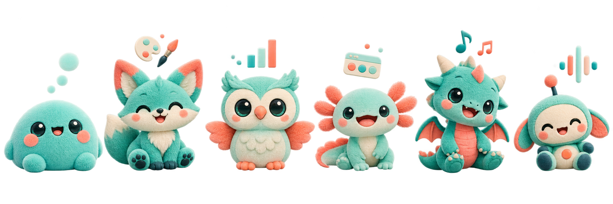
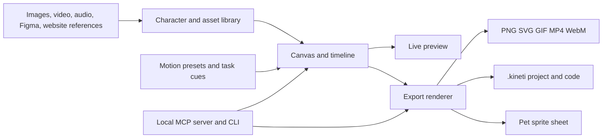

# KinetiCanvas

> Create characters. Direct the motion. Export everywhere.

KinetiCanvas is a local-first character animation studio for the web and desktop. Create an original mascot from references, animate it with editable motion presets, add task cues and sound, preview every change, and export reusable media or code.

> **Project status:** Foundation and first interactive studio shell. The repository contains the product specification, portable project-model package, starter editor interface, Ember brand reference, asset rules, test plan, and contributor setup. Rendering, editable character packages, export, MCP/CLI, and desktop installers remain planned milestones.



## What KinetiCanvas will do

- Create a character from built-in assets or image, video, GIF, website, and Figma references.
- Edit characters with a visual canvas, layers, inspector, timeline, keyframes, and presets.
- Animate idle, walking, waving, thinking, working, reviewing, painting, analyzing, sleeping, and celebration states.
- Add small timeline-driven task cues such as browser, design, analytics, document, terminal, or music symbols.
- Add sound effects and music, then control trim, loop, timing, fades, and volume.
- Preview scenes immediately before export.
- Export PNG, vector-aware SVG, GIF, WebM, MP4, sprite sheets, a portable `.kineti` project, and React/JSON animation code.
- Work offline and store projects locally by default.
- Offer local MCP and CLI tools for Codex, Claude Code, Antigravity, and other compatible agents.

## Product surfaces

| Surface | Purpose |
| --- | --- |
| Browser app | A progressive web app for creating, previewing, and exporting locally. |
| Windows app | Native-feeling local editor with fast file access and hardware-accelerated preview. |
| macOS app | Native-feeling local editor for Apple Silicon and Intel Macs. |
| Linux app | Desktop build where the runtime is supported. |
| MCP + CLI | Agent-friendly local control of explicit KinetiCanvas projects. |

## The starter companions

The asset library will begin with six editable, reusable characters. They are starting points, not limits: users can create their own companions from licensed references.

| Character | Role | Character feel |
| --- | --- | --- |
| Kipi | Creative assistant | Curious, focused, energetic |
| Pomo | Organizer | Calm, cheerful, steady |
| Fynn | Designer | Nimble, playful, precise |
| Olli | Analyst | Thoughtful, observant, methodical |
| Nixi | Explorer | Friendly, expressive, experimental |
| Ember | Builder | Bold, enthusiastic, resilient |

## Demo: the intended workflow

The application is not implemented yet; this walkthrough shows the planned experience.

1. Create a project called **Friday analytics update**.
2. Pick Olli, or import your own character reference.
3. Drag Olli onto the canvas and choose the **Analyze** motion preset.
4. Add an **Analytics** task cue from 00:01 to 00:05 and a soft notification sound at 00:04.
5. Adjust the timeline, preview the loop, and edit colors, expression, cue position, or sound level.
6. Export a transparent GIF for chat, a WebM/MP4 for a presentation, and a `.kineti` project package for future edits.

```text
Project
  Scene: Friday analytics update
    Layer: Olli character
      Motion: Analyze, 0-5 seconds
    Cue: Generic analytics chart, 1-5 seconds
    Audio: Notification chime at 4 seconds
  Exports: GIF, WebM, .kineti
```

## Planned architecture



| Layer | Proposed technology |
| --- | --- |
| Shared interface | React and TypeScript |
| Desktop application | Tauri |
| Browser application | Progressive Web App |
| Scene rendering | WebGL/Canvas with SVG layer support |
| Timeline | Portable JSON scene model |
| Media renderer | Remotion-compatible renderer with desktop FFmpeg export |
| Local storage | SQLite on desktop and IndexedDB in the browser |
| Agent connection | Local MCP server and CLI |

## Repository layout

```text
.
├── README.md                     # This overview
├── KINETICANVAS_PRD.md           # Complete product requirements document
├── CONTRIBUTING.md               # Contributor workflow and standards
├── AGENTS.md                     # Local agent guardrails and project commands
├── .gitignore                    # Local and generated-file exclusions
├── examples/                     # Portable project examples
├── packages/core/                # Tested project-model foundation
├── docs/
│   ├── ARCHITECTURE.md            # Technical boundaries and project model
│   ├── ASSET_LIBRARY.md           # Reusable character-asset contract
│   ├── DESIGN_BRIEF.md            # Editor layout and visual direction
│   ├── MCP_AND_SKILLS.md          # Agent integration plan
│   ├── ROADMAP.md                 # Ordered delivery milestones
│   └── TEST_PLAN.md               # Test coverage and acceptance checks
└── Kipi-pet-run/                  # Existing concept work and pet pipeline artifacts
```

## Setup

Clone the repository and install the workspace dependencies:

```bash
git clone https://github.com/Vishwajeetsrk/KinetiCanvas.git
cd KinetiCanvas
pnpm install
```

Run the current studio shell:

```bash
pnpm --filter @kineticanvas/studio dev
```

Follow the [interactive demo guide](docs/STUDIO_DEMO.md) to select characters, change motions, add task cues and keyframes, toggle a demo audio track, and download the local editable project state.

Verify the portable project model and the production studio build:

```bash
pnpm test
pnpm check
pnpm --filter @kineticanvas/studio build
```

Start with [the PRD](KINETICANVAS_PRD.md), [the brand reference](docs/BRAND_REFERENCE.md), and [the roadmap](docs/ROADMAP.md) for the implementation sequence.

### Planned desktop development prerequisites

Once the application scaffold is added, contributors will need:

- A current Node.js LTS release and a package manager such as pnpm.
- Rust tooling for the Tauri desktop application.
- Platform-specific desktop build dependencies required by Tauri.
- FFmpeg for full local video export verification.

The desktop scaffold and installers are not in this repository yet. The browser studio above is the current runnable surface.

## Releases and installers

There are currently **no published GitHub Releases** because KinetiCanvas does not yet produce verified Windows, macOS, or Linux installers. A release will be created only after the desktop application, local MCP server, CLI, and platform installation tests are complete. See the [studio demo guide](docs/STUDIO_DEMO.md#release-and-installer-rule) for the planned release contents.

## Agent integration example

KinetiCanvas will expose local tools for additive scene work, preview, validation, and export. The final MCP tool names are documented in [MCP and skills](docs/MCP_AND_SKILLS.md).

```text
open_project("/projects/friday-update.kineti")
add_motion(character="olli", preset="analyze", start=0, duration=5)
add_task_cue(type="analytics", start=1, duration=4)
add_audio(asset="notification-chime", at=4)
render_preview()
```

The agent returns a preview for editing before a final export. It may not access arbitrary folders, overwrite files, or invoke remote services without explicit user approval.

## Local-first privacy

- No account is required for the initial release.
- Projects and assets save locally by default.
- API keys and credentials are never stored inside `.kineti` project packages.
- Remote generation and external imports are opt-in.
- MCP listens locally only after the user enables it.

## Documentation

- [Product requirements](KINETICANVAS_PRD.md)
- [Architecture](docs/ARCHITECTURE.md)
- [Reusable asset library](docs/ASSET_LIBRARY.md)
- [Editor design brief](docs/DESIGN_BRIEF.md)
- [MCP and skills](docs/MCP_AND_SKILLS.md)
- [Roadmap](docs/ROADMAP.md)
- [Test plan](docs/TEST_PLAN.md)
- [Contributing](CONTRIBUTING.md)

## License

The license will be chosen before application source code is released. Until then, all concept artwork and repository content remain reserved to their respective owners and contributors.
